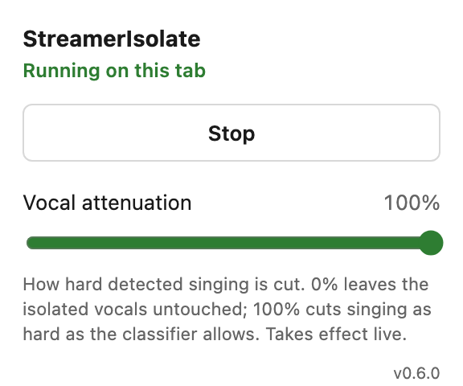
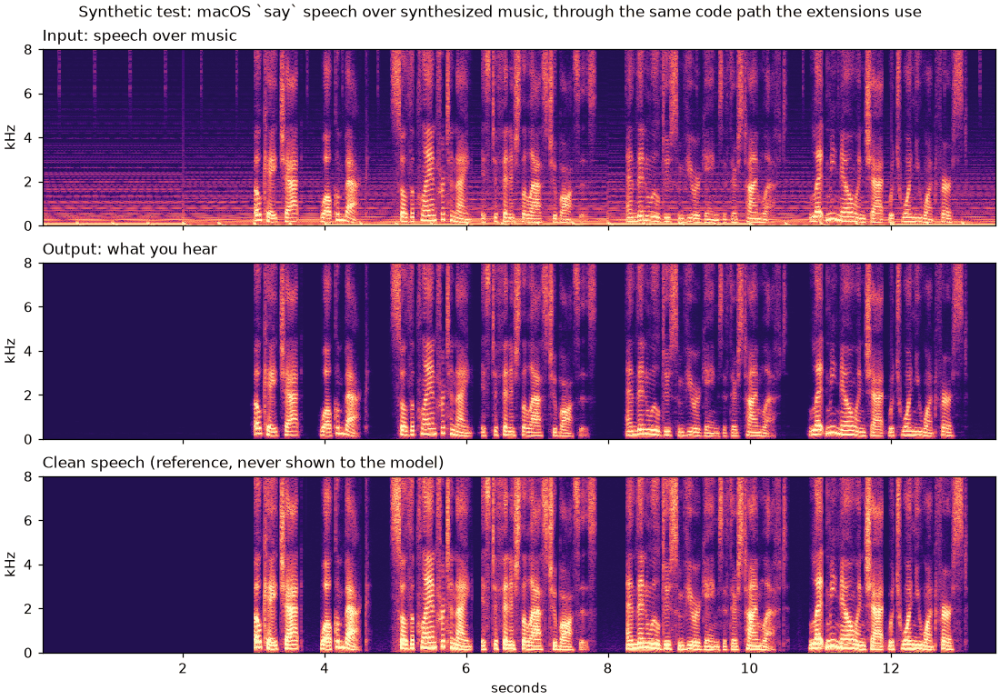
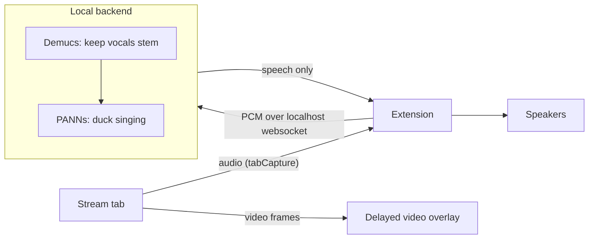

# StreamerIsolate

<picture>
  <source media="(prefers-color-scheme: dark)" srcset="docs/images/popup-dark.png">
  
</picture>

Removes the background music from a livestream in near-real-time and keeps
the streamer's voice, so you can play your own music without the two
competing.

It runs as a Chrome or Firefox extension backed by a local Python process.
The audio goes through a source-separation model (Demucs). A second model
(PANNs) then turns down whatever sounds like singing rather than talking. The
video is delayed by the same few seconds so lips stay in sync.

Python · PyTorch · Demucs · PANNs · WebSockets · WebCodecs · Chrome/Firefox
extensions (Manifest V3) · macOS

<br clear="right">

## What it does



Speech generated with macOS `say` and mixed over synthesized music, then fed
through the same code path the extensions use. Between phrases the music
drops by about 66 dB, and during speech the output matches the clean voice
almost exactly (correlation 0.997). This is the easy case: real streams
are harder, especially songs with vocals (see [Limitations](#limitations)).
`python scripts/make_demo.py` regenerates it and writes the audio to
`build/demo/` so you can listen.



## Install (once, macOS)

Needs Homebrew Python 3.10 or newer (`brew install python@3.12`); macOS's
built-in 3.9 is too old for PyTorch.

**Chrome:** go to `chrome://extensions`, turn on **Developer mode**, click
**Load unpacked**, and pick `extension-chrome/`. Copy the ID it shows, then
run:

```bash
./scripts/install.sh <chrome-extension-id>
```

**Firefox only:** run `./scripts/install.sh` with no ID.

The installer sets up the Python environment, downloads the models (~400MB),
and registers a native messaging host so the extension can start the backend
itself. After that, clicking the extension is all it takes.

## Use

**Chrome:** open a stream, click the StreamerIsolate icon, hit **Start on
this tab**. No audio setup.

**Firefox** can't hand a tab's audio to an extension ([Mozilla bug
1443484](https://bugzilla.mozilla.org/show_bug.cgi?id=1443484)), so audio
goes through a virtual device instead:

1. Install [BlackHole](https://github.com/ExistentialAudio/BlackHole)
   (`brew install blackhole-2ch`) or another virtual audio device.
2. Load the extension: `about:debugging#/runtime/this-firefox` → **Load
   Temporary Add-on** → `extension-firefox/manifest.json`.
3. Set the virtual device as your system output while the stream plays.
4. In the popup, set **Capture the stream's audio from** to the virtual
   device and **Play the cleaned audio to** to your speakers, then hit
   **Start**.

The first start takes about 20s while models load; after that the backend
stays up. Either way it buffers a few seconds before audio comes out.

**The slider** sets how hard detected singing is cut, live. 0% passes the
separated vocals through untouched.

## Limitations

- **Songs with vocals.** Demucs separates vocals from instruments, and has
  no idea a streamer's voice differs from a singer's, so both land in the
  same stem. The singing classifier catches most of it, but when the
  streamer talks *over* a sung part, some of the song gets through.
- **A few seconds of delay**, for the audio and the video with it. Demucs
  needs a window of audio to separate well.
- **The delayed video is re-encoded**, so it's close to the original but not
  identical.
- **macOS only**, and **Firefox needs a virtual audio device**.

## Troubleshooting

- **Nothing playing in Chrome:** `chrome://extensions` → StreamerIsolate →
  *Inspect views: offscreen.html* shows the errors. In Firefox,
  `about:debugging` → *Inspect*.
- **Backend won't start:** check
  `~/Library/Application Support/StreamerIsolate/backend.log`. If
  `/tmp/streamerisolate-host.log` doesn't appear when you click Start, the
  browser never ran the launcher. Re-run `./scripts/install.sh` (with the
  Chrome ID).
- **Slider has no effect:** stop the backend
  (`pkill -f "streamerisolate serve"`) and start it yourself with debug
  output. The extension uses one that's already running:

  ```bash
  STREAMERISOLATE_DEBUG=1 ~/Library/Application\ Support/StreamerIsolate/venv/bin/streamerisolate serve
  ```

  It prints one line per chunk: the strength it received, what the
  classifier heard, and the gain it applied.

## Development

```bash
./scripts/install.sh --dev   # editable install, runs from this checkout
pytest                       # chunking, resampling and classifier tests
./tests/run_js_tests.sh      # extension frame-scheduling tests
```

Use `--dev` only if the checkout is outside Documents, Desktop and Downloads.
macOS blocks browsers from launching anything there, which is also why a
normal install copies the runtime to `~/Library/Application Support`. After
changing backend code, restart the backend (`pkill -f "streamerisolate
serve"`; the next Start relaunches it). After changing an extension, reload
it in the browser.

How it works and why it's built this way, including the approaches that
didn't work out: [docs/design-notes.md](docs/design-notes.md).
